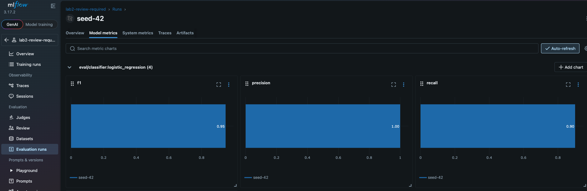
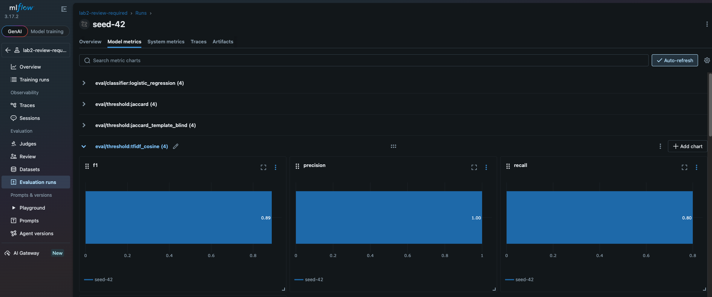

# Отчёт по ЛР 2 — Анализ сходства и оценка качества

**Траектория:** AI и MLOps, подвариант **ML и MLOps** · **Уровень:** основной (углублённый не выполнялся)

## Итог в MLflow

Run `seed-42` эксперимента `lab2-review-required`
(`submission-analyzer experiment --corpus datasets/lab2 --config configs/default.toml --mlflow mlruns`),
вкладка **Model metrics**: метрики на оценочном наборе (`eval`). Подробности — в разделе «Этап Б».

**Классификатор (логистическая регрессия на признаках пары):** F1 0.95, precision 1.00, recall 0.90.



**Пороговый baseline по TF-IDF + cosine:** F1 0.89, precision 1.00, recall 0.80. Слева видны группы метрик всех
четырёх детекторов.



Это результат одного seed на синтетическом корпусе. При перегенерации корпуса с другими seed F1 меняется
от 0.82 до 1.0 (см. «Нестабильность на малом наборе»).

## Этап А — поток и baseline (тег `lab-2-stage-a`)

### Выполненные требования

| Требование | Где реализовано |
|------------|-----------------|
| Корпус ≥ 30 сдач и ≥ 40 размеченных пар, `assignment_id`, `family_id`, происхождение, разные студенты | `scripts/generate_lab2_data.py` → `datasets/lab2/`: 40 сдач, 18 семейств, 74 пары |
| ≥ 5 пар с разрешённым шаблоном | 34 независимые пары с `template_only = true` |
| Семейства разделены между настройкой и оценкой без утечки | `split.json` (19 сдач `tune`, 21 `eval`), `core/corpus.check_no_family_leakage` |
| `derivation_relation` и `template_only` — происхождение примера, а не вердикт | `pairs.jsonl`; `provenance.jsonl` лежит отдельно от `Submission` и не попадает в анализаторы |
| Чтение JSONL итератором, без загрузки корпуса целиком | `similarity/pipeline.py`: генераторы `iter_accepted → iter_features → build_index`, `IngestionService.iter_numbered` |
| Признаки через `tokenize` без комментариев и служебных токенов | `similarity/features.py: tokenize_code` |
| Строки шаблона учитываются отдельно | `CodeFeatures.template_grams`: в score не входят |
| Множества токенных 3-грамм, Jaccard; пустое объединение → `score = null` | `similarity/methods.py: JaccardMethod` |
| Сравнение работ одного задания разных студентов, без self-match, версии студента отдельно | `similarity/pairs.py: candidate_pairs`, `PairKind.SAME_STUDENT` |
| Пары с основаниями: диапазоны исходных строк и сведения о шаблоне | `PairResult.evidence_a/evidence_b`, `template_shared`, `explanation` |
| Описание расхода памяти индекса | раздел «Память индекса» ниже, `scripts/measure_index_memory.py` |
| **AI:** второй метод TF-IDF + cosine; `fit` только на настройке, оценка только `transform` | `similarity/methods.py: TfidfCosineMethod`, CLI `--method tfidf --split` |
| **ML:** признаки пары | `similarity/pair_features.py`, схема `pair-1` (`processing.feature_schema_version`) |
| Сравнение не заменено вопросом к LLM | всё сравнение локальное и детерминированное, модель не вызывается |

Анализ сходства подключён и к контракту ЛР 1: анализатор `token_similarity` (`analyzers/token_similarity.py`)
регистрируется в реестре и выдаёт наибольший Jaccard с работой другого студента. `AnalysisService` при этом
не менялся.

### Приёмка этапа А

| Сценарий | Тест |
|----------|------|
| Точная копия получает максимальное непустое сходство | `test_exact_copy_gets_maximal_non_empty_score` (оба метода), `test_similarity_command_on_corpus` |
| Общий шаблон не превращается в необъяснённое обвинение | `test_template_only_pair_is_explained_not_scored`, `test_template_is_excluded_from_the_score`, `test_token_similarity_template_only_is_not_an_accusation` |
| Пустые признаки обработаны | `test_empty_features`, `test_empty_features_give_null_score` |
| Некорректный код обработан | `test_untokenizable_code_gives_parse_error_not_exception`, `test_syntax_error_is_flagged_but_tokens_are_kept`, `test_syntax_error_is_reported_in_warnings` |
| Top-k не содержит саму работу и сдачи другого задания | `test_top_k_excludes_itself_own_versions_and_other_assignments`, `test_similarity_top_k` |
| Evidence указывает на существующие строки | `test_evidence_points_to_existing_lines_of_each_side`, `test_gram_line_spans_point_to_source_lines` |

Обязательные проверки ЛР 2, которые относятся к этапу А:

| Проверка | Тест |
|----------|------|
| Одинаковый код | `test_exact_copy_gets_maximal_non_empty_score` |
| Переименованные переменные | `test_renamed_variables_stay_highly_similar`, `test_without_normalization_renaming_lowers_jaccard` |
| Независимые решения | `test_independent_solutions_score_lower_than_derived` |
| Разрешённый шаблон | `test_template_only_pair_is_explained_not_scored`, `test_commented_template_line_still_counts_as_template` |
| Пустой ввод | `test_empty_features`, `test_empty_features_give_null_score` |
| SyntaxError | `test_syntax_error_is_flagged_but_tokens_are_kept`, `test_broken_code_gives_null_score_with_reason` |
| Self-match | `test_no_self_match_and_no_cross_assignment_pairs` |
| Повторная версия студента | `test_versions_of_one_student_are_compared_separately` |
| Отсутствие утечки семейств | `test_no_family_leakage_between_tune_and_eval`, `test_leakage_check_detects_a_family_on_both_sides` |
| Ленивое чтение | `test_reading_is_lazy`, `test_nothing_is_read_before_iteration` |
| TF-IDF не переобучается на оценке | `test_tfidf_scoring_does_not_change_vocabulary_or_idf`, `test_tfidf_cannot_be_refitted` |
| Код студента не исполняется | `test_code_is_never_executed` |

Проверки невалидного результата модели и воспроизводимости эксперимента относятся к этапу Б
(классификатор и MLflow).

### Как устроен корпус

> Раздел описывает корпус на момент тега `lab-2-stage-a`. На этапе Б корпус расширен: добавлен вид `modified`
> и стратифицированное разбиение. Сейчас в корпусе 48 сдач и 110 пар (см. «Этап Б»).

На каждое из 4 заданий написано 4 независимых решения. Решение — это оригинал семейства; к нему программно
добавлены производные: точная копия, переформатирование (отступы в 2 пробела, комментарии, пустые строки) и
переименование идентификаторов через `tokenize`. Набор производных у семейств разный. Ещё есть две особые
сдачи: решение, почти целиком состоящее из шаблона, и решение с `SyntaxError`. Также есть две повторные
версии одного студента. Все сдачи используют шаблон задания, поэтому у большинства независимых пар общие
строки — только строки шаблона.

Семейства каждого задания перемешиваются с seed 42 и делятся пополам между `tune` и `eval`. Пара получает
сторону своих семейств; пары между семействами разных сторон не размечаются, иначе одна работа оказалась бы
по обе стороны.

### Память индекса

Индекс (`FeatureIndex`) хранит для каждой сдачи словарь «n-грамма → диапазоны строк» и множество шаблонных
n-грамм; исходный `text`/`code` в нём не хранится. Объём — O(N · G), где N — число сдач, G — число различных
n-грамм в сдаче (здесь около 70–80). Потоковое чтение экономит память только на входе: одновременно
обрабатывается одна строка файла. Сам индекс при этом растёт линейно с корпусом, поэтому константным по памяти
конвейер не становится.

Замер (`python scripts/measure_index_memory.py --sizes 40 1000 --repeats 3`, `tracemalloc`, медиана из 3
повторов, seed 42, ngram 3; Python 3.13.16, macOS 15.7 arm64). Для размера 1000 корпус дополнен
синтетическими копиями: они нужны только для нагрузки.

| Сдач | n-грамм всего | Индекс, KiB | Пик при построении, KiB | KiB на сдачу |
|------|---------------|-------------|--------------------------|--------------|
| 40 | 2 818 | 545.9 | 652.3 | 13.6 |
| 1000 | 77 531 | 15 046.8 | 15 786.2 | 15.0 |

Около 190 байт на n-грамму: кортеж из трёх строк, ключ словаря и кортеж диапазонов. Строки токенов
(`ID`, `(`, `for` …) интернированы и почти не занимают место. Если индекс станет узким местом, n-граммы
можно хешировать в целые числа, а диапазоны строк хранить только на время построения evidence.
Профилирование 100/1000/5000 записей выполняется на этапе Б.

### Команды проверки

```bash
pip install -e ".[dev]"                   # ставит scikit-learn
pytest -q                                 # 353 passed

python scripts/generate_lab2_data.py      # корпус datasets/lab2/ (seed=42), повторный запуск даёт те же файлы

# все пары одного задания, Jaccard
submission-analyzer similarity datasets/lab2/submissions.jsonl \
    --assignments datasets/lab2/assignments.json --config configs/default.toml

# TF-IDF: fit только на стороне tune из split.json
submission-analyzer similarity datasets/lab2/submissions.jsonl \
    --assignments datasets/lab2/assignments.json --config configs/default.toml \
    --method tfidf --split datasets/lab2/split.json

# top-k кандидатов для одной сдачи
submission-analyzer similarity datasets/lab2/submissions.jsonl \
    --assignments datasets/lab2/assignments.json --submission sub-0001 --top-k 5

python scripts/measure_index_memory.py    # память индекса
```

Контрольный прогон по всему корпусу. Это не оценка качества: порог не подбирался, разбиение на
`tune`/`eval` здесь не учитывается.

| Тип пары | Пар | Jaccard: мин – медиана – макс | TF-IDF: мин – медиана – макс |
|----------|-----|-------------------------------|------------------------------|
| exact_copy | 4 | 1.000 – 1.000 – 1.000 | 1.000 – 1.000 – 1.000 |
| reformatted | 12 | 1.000 – 1.000 – 1.000 | 1.000 – 1.000 – 1.000 |
| renamed | 12 | 1.000 – 1.000 – 1.000 | 1.000 – 1.000 – 1.000 |
| independent, template_only | 34 | 0.048 – 0.200 – 0.561 | 0.043 – 0.224 – 0.849 |
| independent, остальные | 12 | 0.138 – 0.178 – 0.561 | 0.146 – 0.194 – 0.849 |

### Известные ограничения

- **Нормализация имён склеивает переименование с копией.** При `normalize_identifiers = true` у
  переименованного варианта те же n-граммы, что у оригинала, поэтому score равен 1.0. С
  `normalize_identifiers = false` переименование снижает score (`test_without_normalization_renaming_lowers_jaccard`).
  Это настройка конфигурации, и она входит в `config_hash`.
- **Синтетические производные слишком простые.** Все три вида преобразований не меняют последовательность
  токенов, поэтому на этом корпусе они отделяются от независимых решений тривиально. Выводы о
  реальных студентах по такому корпусу делать нельзя.
- **Независимые решения на одной идиоме близки.** Самая похожая независимая пара — `sub-0010` и `sub-0038`
  (0.56 по Jaccard, 0.85 по TF-IDF). Обе считают слова циклом `counts[word] = counts.get(word, 0) + 1`.
  Сходство здесь — сигнал для ручного разбора, а не доказательство копирования. TF-IDF усиливает такие пары:
  общие n-граммы редки в наборе настройки и получают большой вес.
- **Jaccard чувствителен к длине.** Короткая работа, целиком содержащаяся в длинной, получает низкий score.
- **TF-IDF не видит n-граммы, которых нет в наборе настройки.** Если у пары нет ни одной n-граммы из словаря
  `tune`, результат — `insufficient_data`.
- **Сравнение — полный перебор пар внутри задания**, O(n²) на задание. Индекс держится в памяти целиком.
- **`ast.parse` используется только для флага `syntax_error`.** Сравнение структуры AST не реализовано: это
  вариант Python Core, а не AI.

## Этап Б — измерения и ML-классификатор (тег `lab-2`)

### Выполненные требования

| Требование | Где реализовано |
|------------|-----------------|
| ≥ 2 метода на одинаковом фиксированном наборе | `evaluation/experiment.py`: Jaccard и TF-IDF (пороговые) и классификатор на одном `eval` из `split.json` |
| Порог `review_required` выбран на настройке | `evaluation/threshold.py`: максимум F1 на `tune`, при равенстве — больший порог |
| На оценке: матрица ошибок, precision, recall, F1, доля неопределённых | `evaluation/metrics.py`, таблица ниже |
| Разобрано ≥ 3 ошибок, включая общий шаблон | раздел «Разбор ошибок» |
| Wall time и peak memory на 100 / 1000 / 5000, ≥ 3 повтора, медиана, среда, seed | `scripts/profile_similarity.py`, раздел «Профилирование» |
| **ML:** классификатор `review_required` на признаках пары против порогового baseline | `evaluation/classifier.py`: `LogisticRegression` на признаках `pair-1` |
| **ML:** MLflow хранит параметры, метрики, артефакты разбиения | `adapters/tracking.py`, `experiment --mlflow mlruns` |
| **ML:** нестабильность на малом наборе объяснена | `scripts/run_seed_sweep.py`, раздел «Нестабильность» |

Конкурентность в этой работе не измерялась: по заданию её замеры откладываются до соответствующей лекции.

### Доработка корпуса

На корпусе этапа А все производные пары получали score 1.0, а все точные копии лежали в `eval`. Метрики
вышли бы тривиальными. Поэтому:

- добавлен вид `modified`: копия, в которую вставлены 2–3 посторонние инструкции (`steps = 0`,
  `for _ in range(0): pass` и т. п.). Такая правка меняет последовательность токенов;
- разбиение стратифицировано: каждый набор производных попадает в `tune` для половины заданий и в `eval` для
  другой. На обеих сторонах есть все виды `derivation_relation` и пары `template_only`.

Итог (seed 42): 48 сдач, 18 семейств, 110 пар (`tune` 55, из них 20 производных; `eval` 55, из них 20
производных). Независимых пар 70, из них 56 с `template_only`. Пар без score на этом корпусе нет, доля
неопределённых равна 0.

### Результаты на оценочном наборе (seed 42)

`submission-analyzer experiment --corpus datasets/lab2 --config configs/default.toml --mlflow mlruns`.
Положительный класс — пара производных одной работы.

| Детектор | Порог (по `tune`) | TP | FP | FN | TN | Precision | Recall | F1 | Неопред. |
|----------|-------------------|----|----|----|----|-----------|--------|----|----------|
| `threshold:jaccard` | 0.590 | 17 | 0 | 3 | 35 | 1.000 | 0.850 | 0.919 | 0 |
| `threshold:tfidf_cosine` | 0.671 | 16 | 0 | 4 | 35 | 1.000 | 0.800 | 0.889 | 0 |
| `classifier:logistic_regression` | p ≥ 0.5 | 18 | 0 | 2 | 35 | 1.000 | 0.900 | 0.947 | 0 |
| `threshold:jaccard_template_blind` (абляция) | 0.737 | 18 | 0 | 2 | 35 | 1.000 | 0.900 | 0.947 | 0 |

На `tune` все детекторы дают F1 = 1.0: классы там разделимы. Это ещё одна причина не доверять одной цифре.
Срабатываний на `fallback` нет: классификатор вернул корректные вероятности для всех пар.

Наибольший score среди пар `eval`, общих только по шаблону (`template_only_max`): Jaccard 0.328, TF-IDF 0.614,
классификатор 0.424, Jaccard без исключения шаблона 0.511. У всех пороговых детекторов он ниже порога.
Шаблон на seed 42 не приводит к сигналу.

### Разбор ошибок

1. **`modified`-копия короткой функции (FN у Jaccard, TF-IDF и классификатора).** Пары `sub-0023`/`sub-0025`
   и `sub-0024`/`sub-0025`, `lab-03-transpose`. Оригинал — тело из трёх строк (`if not matrix: return []`,
   `return [list(row) for row in zip(*matrix)]`). В копию вставлены два фрагмента (3 строки): `checked = []` и
   `for _ in range(0): pass`. Собственных n-грамм у короткой функции мало, поэтому вставка меняет
   заметную их долю: Jaccard 0.475, TF-IDF 0.454, вероятность классификатора 0.277. Это ограничение
   «мешка n-грамм»: чем короче работа, тем сильнее одна правка сдвигает score. Именно на таких парах
   ручной разбор важнее всего, а порог их пропускает.
2. **TF-IDF пропускает копию, которую ловит Jaccard.** Пары `sub-0004`/`sub-0006` и `sub-0005`/`sub-0006`
   (`lab-01-fizzbuzz`, `modified`): Jaccard 0.616 (выше порога 0.590), TF-IDF 0.663 (ниже порога 0.671). В
   `tune` у `modified`-пар TF-IDF не опускался ниже 0.72, поэтому порог встал высоко. Здесь в копию вставлены
   три фрагмента (`if False: print(...)`, `for _ in range(0): pass`, `steps = 0; steps += 1`, всего 6 строк).
   Они добавляют в вектор новые n-граммы, и косинус опускается чуть ниже порога. Порог, подобранный на 20
   положительных парах, переносится на `eval` неточно: методы ошибаются на разных парах, а ошибки лежат у
   самого порога.
3. **Общий шаблон и общая идиома (FP, seed 5).** При seed 5 TF-IDF выбрал на `tune` низкий порог 0.403 и дал
   9 FP на `eval`. Среди них пара `sub-0004`/`sub-0007` (`lab-01-fizzbuzz`), размеченная `template_only`:
   текстово общих строк у них только строки шаблона. Шаблонные n-граммы при этом из score исключены
   (evidence: строки 3–5 и 2–3, не шаблон). Совпадение даёт сама идиома FizzBuzz: `for ID in range(1, ID + 1)`,
   `% 3 == 0 else`, `% 5 == 0 else`. Вывод: исключение шаблона работает, но независимые решения одной
   задачи похожи и без шаблона, а TF-IDF придаёт редким в `tune` идиомам большой вес.
4. **Расхождение разметки и признаков (FP, seed 1 и 5).** Пара `sub-0019`/`sub-0046` (`lab-02-word-count`)
   размечена `template_only`, потому что по тексту общие строки — только шаблон. Но обе считают слова
   идиомой `counts[w] = counts.get(w, 0) + 1`, только с разными именами (`key` и `word`). После нормализации
   имён эти строки совпадают, отсюда Jaccard 0.49 и TF-IDF 0.80. Кроме того, `sub-0046` не разбирается
   (`SyntaxError`) и сравнивается только по токенам, о чём есть предупреждение в `warnings`. Метка
   `template_only` строится по сырому тексту, а признаки — по нормализованным токенам. Это разные понятия
   «общего», и вывод «шаблон вызвал ложное срабатывание» здесь был бы неверен.

**Абляция шаблона.** Без исключения шаблона (`jaccard_template_blind`) F1 на seed 42 даже выше: 0.947 против
0.919. Шаблон поднимает score всех пар одного задания, и порог, подобранный на `tune`, поднимается вместе с ним
(0.737 против 0.590). Метрики это не ухудшает, но у отдельной пары тогда нельзя объяснить, какая часть
сходства разрешена. Поэтому шаблон исключается ради объяснимости evidence, а не ради F1. При фиксированном
пороге (например, если шаблон добавлен после настройки) исключение обязательно, см. «Защита».

### Нестабильность на малом наборе

`python scripts/run_seed_sweep.py`: корпус перегенерирован с seed 1–5 и 42 (в каждом 55–56 пар `eval`).

| Детектор | F1 eval: мин | медиана | макс |
|----------|--------------|---------|------|
| `threshold:jaccard` | 0.878 | 0.965 | 1.000 |
| `threshold:tfidf_cosine` | 0.816 | 0.939 | 1.000 |
| `classifier:logistic_regression` | 0.878 | 0.974 | 1.000 |
| `threshold:jaccard_template_blind` | 0.878 | 0.947 | 1.000 |

Разброс между seed (до 0.18 по F1) больше разницы между методами внутри одного seed. Ранжирование методов
тоже меняется: на seed 42 классификатор лучше Jaccard, на seed 1 хуже (0.878 против 0.930). В `eval` всего
20 положительных пар, и одна ошибка меняет recall на 0.05. Поэтому по этому корпусу нельзя утверждать, что
классификатор лучше порога, и нельзя говорить о готовности к реальным решениям. Это эксперимент на
синтетике, а не оценка качества системы.

### Профилирование

Что измеряется: чтение JSONL → валидация → признаки `tokenize` → индекс → Jaccard для всех пар каждого задания.
Записи сверх корпуса — синтетические копии сдач корпуса с добавленными строками; они только для нагрузки и
распределены по 4 заданиям корпуса. Время (`time.perf_counter`) и пиковая память (`tracemalloc`) измеряются в
разных прогонах. Каждое значение — медиана 3 повторов.

Среда: Python 3.13.16, macOS 15.7 arm64 (Apple Silicon), seed 42, ngram 3, `normalize_identifiers = true`,
порог `review_required` 0.59 (из эксперимента).

**Узкое место.** `cProfile` на 1000 записях до оптимизации: из 4.6 с больше половины (2.2 с cumulative)
занимает `_evidence`, то есть построение диапазонов строк для **каждой** пары. Кроме того, все 124 506
результатов с evidence держатся в памяти до конца. На 5000 записях это 3.1 млн пар.

**Оптимизация.** Пары генерируются потоком (`iter_compare`). Evidence строится только для пар с
`review_required`, и в памяти остаются только они. Score, `shared_grams` и решение не меняются
(`test_threshold_keeps_scores_and_limits_evidence_to_review_pairs`, все контрактные тесты повторены).

| Записей | Пар | До: время, с | До: пик, МиБ | После: время, с (3 прогона) | После: пик, МиБ |
|---------|-----|--------------|--------------|------------------------------|-----------------|
| 100 | 1 206 | 0.057 | 2.3 | 0.045 (0.05 / 0.04 / 0.04) | 1.6 |
| 1 000 | 124 506 | 3.680 | 111.5 | 2.295 (2.29 / 2.49 / 2.25) | 32.8 |
| 5 000 | 3 122 524 | не запускалось | ≈ 3 ГиБ (оценка) | 57.453 (59.49 / 57.45 / 54.68) | 499.8 |

Вариант «до» на 5000 записях не запускался. Оценка памяти — линейная экстраполяция по числу пар
(111.5 МиБ на 124 тыс. пар).

На 1000 записях оптимизация дала −38 % времени и −71 % памяти. Время растёт как O(n²) по числу сдач одного
задания: 5× записей дают 25× пар и 25× времени. После оптимизации `cProfile` на 5000 записях (68 с под
профилировщиком) распределяется так:

- `JaccardMethod.score` — 21 с;
- evidence для отмеченных пар — 18 с;
- `template_overlap` — 8.6 с;
- остальное — собственное время `compare`.

Около 40 % синтетических пар выше порога, потому что синтетика — копии корпуса. Поэтому память на 5000
записях (500 МиБ) — это в основном отмеченные пары с evidence. На реальном корпусе таких пар было бы
меньше.

Следующий шаг, если понадобится, — не перебирать все пары. Кандидаты можно отбирать по общим редким n-граммам
(инвертированный индекс). Это вариант Backend, на основном уровне ML он не требуется.


### MLflow

`submission-analyzer experiment ... --mlflow mlruns` создаёт run в эксперименте `lab2-review-required`
(SQLite `mlruns/mlflow.db`, артефакты в `mlruns/artifacts/`, каталог в `.gitignore`). В run записываются:

- params: `config_hash`, seed, `feature_schema_version`, ngram, нормализация, методы, размеры `tune`/`eval` и
  SHA-256 всех файлов корпуса;
- метрики: `tune/<детектор>/f1|precision|recall|undetermined_share`, `eval/...`, `threshold/<детектор>`,
  `fallbacks/<детектор>`;
- артефакты: `data/split.json`, `data/pairs.jsonl`, `data/provenance.jsonl`, `experiment.json`, модель
  (`mlflow.sklearn`), тег `feature_schema_version`.

Воспроизводимость: повторный запуск даёт тот же `experiment.json` (`test_experiment_is_reproducible`), а
модель, загруженная из run, даёт те же вероятности (`test_logged_model_reproduces_predictions`).
Просмотр: `mlflow ui --backend-store-uri sqlite:///mlruns/mlflow.db`.

### Обязательные проверки ЛР 2 (этап Б)

| Проверка | Тест |
|----------|------|
| Метрики на известном примере, доля неопределённых | `test_hand_computed_example`, `test_undetermined_pairs_are_not_counted_as_errors` |
| Порог выбирается только по настройке | `test_eval_labels_do_not_influence_anything_fitted`, `test_tie_goes_to_the_higher_threshold` |
| Отсутствие утечки семейств | `test_family_leakage_stops_the_experiment`, `test_tfidf_vocabulary_comes_from_tune_submissions_only` |
| **AI:** невалидный результат модели | `test_invalid_probability_falls_back_to_the_baseline`, `test_malformed_output_falls_back_for_the_whole_batch` |
| **AI:** несовместимая схема признаков | `test_incompatible_feature_schema_is_rejected`, `test_incompatible_feature_schema_stops_the_experiment` |
| **AI:** воспроизводимость сохранённого эксперимента | `test_experiment_is_reproducible`, `test_mlflow_run_stores_params_metrics_and_artifacts`, `test_logged_model_reproduces_predictions` |
| Оптимизация не меняет score | `test_threshold_keeps_scores_and_limits_evidence_to_review_pairs` |
| Новый шаблон (репетиция защиты) | `test_new_template_moves_shared_block_out_of_the_score`, `test_new_template_changes_the_recorded_corpus_version` |

Остальные обязательные проверки (одинаковый код, переименование, независимые решения, шаблон, пустой ввод,
SyntaxError, self-match, повторная версия) закрыты на этапе А, см. таблицу выше.

### Защита

**Преподаватель добавляет новый шаблон.** Меняется `allowed_template` в `assignments.json`. Это входные
данные, а не таблица конфигурации, поэтому версия фиксируется хешем `sha256:assignments.json` в params
run MLflow. Два run (до и после) различаются по этому хешу, и их метрики можно сравнить в `mlflow ui`.
Влияние на пару: строки нового шаблона перестают давать собственные n-граммы и evidence, score пар, общих
по этим строкам, падает, а число шаблонных n-грамм растёт
(`test_new_template_moves_shared_block_out_of_the_score`). Порог, подобранный до изменения шаблона, после
него может стать слишком строгим, поэтому эксперимент нужно перезапустить.

**Почему score не доказывает нарушение.** Score измеряет долю общих токенных n-грамм. Независимые решения
одной задачи сходятся на одних и тех же идиомах (ошибки 3 и 4), короткие функции почти неизбежно похожи, а
настоящая копия с правками может получить низкий score (ошибка 1). Score и `review_required` — только сигнал
для ручного разбора. Решение принимает преподаватель (в ЛР 4 — `TeacherDecision`).

**Где возможна утечка данных.**

- Производные одной работы по разные стороны разбиения: закрыто разбиением по семействам и
  `check_no_family_leakage`.
- Словарь TF-IDF, собранный на всём корпусе: закрыто `fit` только на `tune`.
- Подбор порога или выбор признаков по `eval`: порог и веса подбираются только на `tune`, тест меняет метки
  `eval` и проверяет, что ничего обученного не изменилось.
- Повторный подбор параметров «до хорошего результата на `eval`»: организационная утечка. Код её не
  ловит, от неё защищает только фиксация конфигурации и seed в MLflow.
- Сам генератор корпуса: производные сделаны известными правилами, а модель учится узнавать именно эти
  правила.

**Какие выводы нельзя делать по малому корпусу.**

- Нельзя говорить о точности на реальных студентах: данные синтетические, а преобразования известны заранее.
- Нельзя утверждать, что один метод лучше другого: разница меньше разброса между seed.
- Нельзя доверять значению порога за пределами этого корпуса.
- Нельзя считать низкую долю FP гарантией того, что шаблон или идиома не дадут ложный сигнал на других
  заданиях (seed 1 и 5).

### Команды проверки (этап Б)

```bash
pip install -e ".[dev]"                   # ставит scikit-learn и mlflow
pytest -q                                 # 401 passed
python scripts/generate_lab2_data.py      # корпус (seed 42)
submission-analyzer experiment --corpus datasets/lab2 --config configs/default.toml \
    --mlflow mlruns --out out/experiment.json
submission-analyzer similarity datasets/lab2/submissions.jsonl --assignments datasets/lab2/assignments.json \
    --threshold 0.59                      # review_required + evidence только для отмеченных пар
python scripts/run_seed_sweep.py
python scripts/profile_similarity.py --variant all-evidence --sizes 100 1000
python scripts/profile_similarity.py --cprofile 5000
mlflow ui --backend-store-uri sqlite:///mlruns/mlflow.db
```

### Известные ограничения (этап Б)

- Корпус синтетический и маленький (20 положительных пар в `eval`). Метрики неустойчивы, см. «Нестабильность».
- `modified` — один простой вид правки (вставка инструкций). Реальные правки (перестановка, рефакторинг,
  частичная переписка) не моделируются.
- Признаки пары почти полностью определяются двумя score, поэтому классификатор мало отличается от порога. Его
  преимущество на seed 42 не воспроизводится на других seed.
- Метка `template_only` считается по сырому тексту строк, а сходство — по нормализованным токенам (ошибка 4).
- Сравнение — полный перебор пар внутри задания (O(n²)). Оптимизация сократила память и работу на построение
  evidence, но не число сравнений.
- Шаблон хранится в `assignments.json`, а не в конфигурации, поэтому его изменение видно по хешу файла в
  MLflow, а не по `config_hash` отчётов `analyze`.
